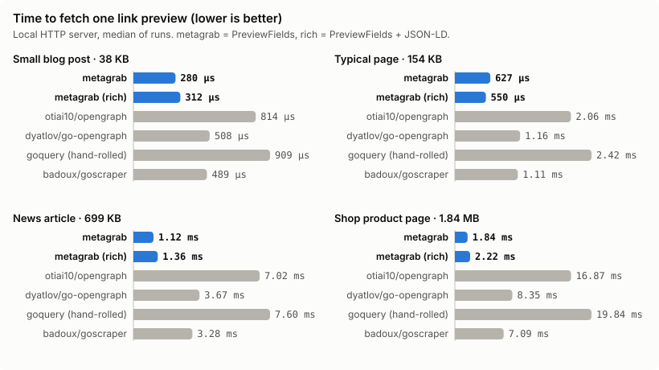
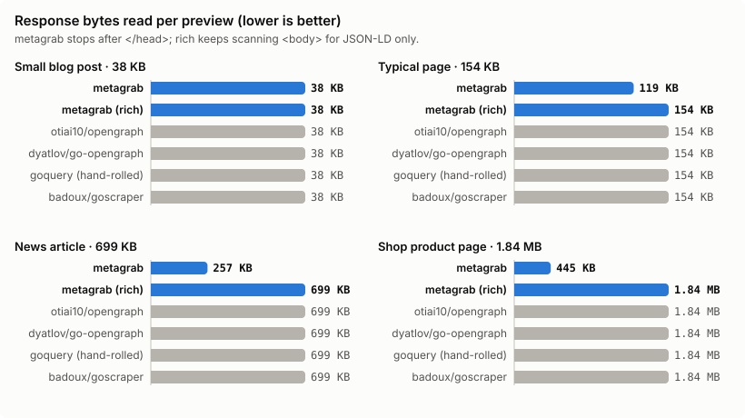
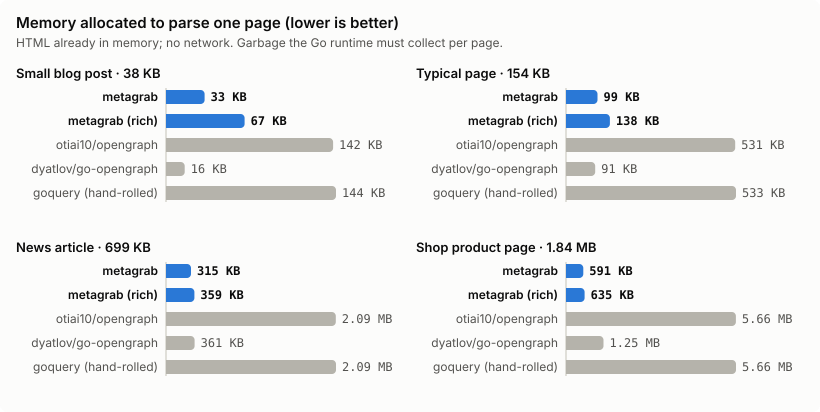
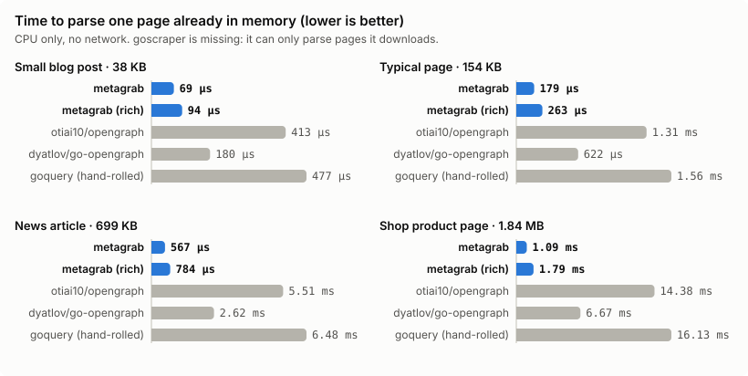

# Benchmarks

Generated by `cd bench && go run .` on 2026-11-07. Go 1.26.0, linux/amd64, Intel(R) Xeon(R) Processor @ 2.10GHz. Median of 5 runs per case.

Do not trust these numbers blindly: run the harness on your own hardware. The corpus is synthetic and deterministic so anyone can reproduce it; see [Method](#method).

## Libraries

| Library | Module | Version |
| --- | --- | --- |
| metagrab | `github.com/josephgoksu/metagrab` | this repository |
| otiai10/opengraph | `github.com/otiai10/opengraph/v2` | v2.2.0 |
| dyatlov/go-opengraph | `github.com/dyatlov/go-opengraph/opengraph` | v0.0.0-20220524092352-606d7b1e5f8a |
| goquery (hand-rolled) | `github.com/PuerkitoBio/goquery` | v1.13.0 |
| badoux/goscraper | `github.com/badoux/goscraper` | v0.0.0-20190827161153-36995ce6b19f |

## Fetch: time per link preview

## Fetch: bytes read per preview

## Parse: memory per page

## Parse: time per page

## Features

Rows marked *measured* were checked by running each library against the fixtures. The others come from reading each library's source at the version above.

| Feature | metagrab | otiai10/opengraph | dyatlov/go-opengraph | goquery (hand-rolled) | badoux/goscraper |
| --- | :-: | :-: | :-: | :-: | :-: |
| Title *(measured)* | ✅ | ✅ | ✅ | ✅ | ✅ |
| Description *(measured)* | ✅ | ✅ | ✅ | ✅ | ✅ |
| Preview image as absolute URL *(measured)* | ✅ | ✅ | ◐ | ◐ | ✅ |
| Best favicon (apple-touch-icon over icon) *(measured)* | ✅ | ◐ | ❌ | ◐ | ◐ |
| Canonical URL *(measured)* | ✅ | ❌ | ❌ | ✅ | ❌ |
| Author and published time *(measured)* | ✅ | ❌ | ❌ | ✅ | ❌ |
| Twitter Card *(measured)* | ✅ | ❌ | ❌ | ✅ | ❌ |
| JSON-LD (including in <body>) *(measured)* | ✅ | ❌ | ❌ | ✅ | ❌ |
| Non-UTF-8 page decoded *(measured)* | ✅ | ❌ | ❌ | ❌ | ✅ |
| Stops reading after </head> when it can | ✅ | ❌ | ❌ | ❌ | ❌ |
| SSRF protection (private IPs, redirects, DNS rebinding) | ✅ | ❌ | – | – | ❌ |
| Retries with backoff and Retry-After | ✅ | ❌ | – | – | ❌ |
| Response size limit | ✅ | ❌ | – | – | ❌ |
| context.Context cancellation | ✅ | ✅ | – | – | ❌ |
| oEmbed (YouTube, Vimeo, Spotify, X, ...) | ✅ | ❌ | – | – | ❌ |
| Structured errors with codes | ✅ | ❌ | ❌ | ❌ | ❌ |
| Bulk fetch with bounded concurrency | ✅ | ❌ | – | – | ❌ |
| HTTP API and CLI included | ✅ | ◐ | ❌ | ❌ | ❌ |

✅ yes · ◐ partial (for example a relative URL, or any icon instead of the best one) · ❌ no · – not applicable (parse-only library)

## Raw numbers

### fetch

| Library | Page | Time/op | Alloc/op | Allocs/op | Body read/op |
| --- | --- | ---: | ---: | ---: | ---: |
| metagrab | small | 280 µs | 29 KB | 561 | 38 KB |
| metagrab | medium | 627 µs | 100 KB | 896 | 119 KB |
| metagrab | large | 1.12 ms | 300 KB | 1582 | 257 KB |
| metagrab | huge | 1.84 ms | 563 KB | 2135 | 445 KB |
| metagrab (rich) | small | 312 µs | 63 KB | 600 | 38 KB |
| metagrab (rich) | medium | 550 µs | 122 KB | 884 | 154 KB |
| metagrab (rich) | large | 1.36 ms | 326 KB | 1590 | 699 KB |
| metagrab (rich) | huge | 2.22 ms | 589 KB | 2142 | 1.84 MB |
| otiai10/opengraph | small | 814 µs | 149 KB | 3183 | 38 KB |
| otiai10/opengraph | medium | 2.06 ms | 538 KB | 9835 | 154 KB |
| otiai10/opengraph | large | 7.02 ms | 2.10 MB | 36391 | 699 KB |
| otiai10/opengraph | huge | 16.87 ms | 5.67 MB | 88421 | 1.84 MB |
| dyatlov/go-opengraph | small | 508 µs | 23 KB | 1336 | 38 KB |
| dyatlov/go-opengraph | medium | 1.16 ms | 99 KB | 3806 | 154 KB |
| dyatlov/go-opengraph | large | 3.67 ms | 368 KB | 13630 | 699 KB |
| dyatlov/go-opengraph | huge | 8.35 ms | 1.26 MB | 32835 | 1.84 MB |
| goquery (hand-rolled) | small | 909 µs | 152 KB | 3281 | 38 KB |
| goquery (hand-rolled) | medium | 2.42 ms | 541 KB | 9932 | 154 KB |
| goquery (hand-rolled) | large | 7.60 ms | 2.10 MB | 36490 | 699 KB |
| goquery (hand-rolled) | huge | 19.84 ms | 5.67 MB | 88519 | 1.84 MB |
| badoux/goscraper | small | 489 µs | 160 KB | 591 | 38 KB |
| badoux/goscraper | medium | 1.11 ms | 608 KB | 916 | 154 KB |
| badoux/goscraper | large | 3.28 ms | 2.30 MB | 1717 | 699 KB |
| badoux/goscraper | huge | 7.09 ms | 4.57 MB | 2362 | 1.84 MB |

### parse

| Library | Page | Time/op | Alloc/op | Allocs/op |
| --- | --- | ---: | ---: | ---: |
| metagrab | small | 60 µs | 24 KB | 463 |
| metagrab | medium | 168 µs | 83 KB | 741 |
| metagrab | large | 491 µs | 282 KB | 1426 |
| metagrab | huge | 1.05 ms | 544 KB | 1977 |
| metagrab (rich) | small | 90 µs | 57 KB | 502 |
| metagrab (rich) | medium | 232 µs | 117 KB | 786 |
| metagrab (rich) | large | 786 µs | 321 KB | 1492 |
| metagrab (rich) | huge | 1.61 ms | 583 KB | 2043 |
| otiai10/opengraph | small | 418 µs | 142 KB | 3091 |
| otiai10/opengraph | medium | 1.43 ms | 531 KB | 9742 |
| otiai10/opengraph | large | 5.83 ms | 2.09 MB | 36295 |
| otiai10/opengraph | huge | 14.95 ms | 5.66 MB | 88319 |
| dyatlov/go-opengraph | small | 193 µs | 16 KB | 1244 |
| dyatlov/go-opengraph | medium | 752 µs | 91 KB | 3714 |
| dyatlov/go-opengraph | large | 2.81 ms | 361 KB | 13538 |
| dyatlov/go-opengraph | huge | 7.38 ms | 1.25 MB | 32740 |
| goquery (hand-rolled) | small | 537 µs | 144 KB | 3189 |
| goquery (hand-rolled) | medium | 1.73 ms | 533 KB | 9840 |
| goquery (hand-rolled) | large | 7.11 ms | 2.09 MB | 36392 |
| goquery (hand-rolled) | huge | 17.95 ms | 5.66 MB | 88414 |

## Method

- **Corpus.** Four generated pages, from a 40 KB blog post to a 1.9 MB product page, shaped like real pages: a full set of Open Graph and Twitter tags, several icons, inline CSS and JavaScript in the head, and a long body with JSON state at the end. The two large pages put their JSON-LD in the body. See `bench/corpus.go`.
- **Fetch.** Each library downloads the page from a local `httptest` server. Parse-only libraries get the response body from `http.Client.Get`, the way you would wire them into a service. A counting transport records how many body bytes each library actually reads. No real network is involved, so the time is mostly CPU, and the bytes-read chart is the one that predicts real-world latency and bandwidth.
- **Parse.** Each library parses the same in-memory bytes. goscraper has no parse-only API, so it appears only in the fetch charts.
- **metagrab modes.** `metagrab` uses `PreviewFields` (title, description, Open Graph, Twitter, image, favicon, canonical), which is the closest match to what the other libraries return. `metagrab (rich)` adds JSON-LD, which means scanning the body for `<script type="application/ld+json">`.
- **Fairness.** Each library runs with its defaults. The libraries do not extract the same fields (see the feature table), so less work can be faster. The goquery baseline uses CSS selectors for the same fields metagrab returns.
- **Reproduce.** `cd bench && go run .` rewrites this file, the SVG charts and `results.json`. `go run . -quick` takes one sample per case.
