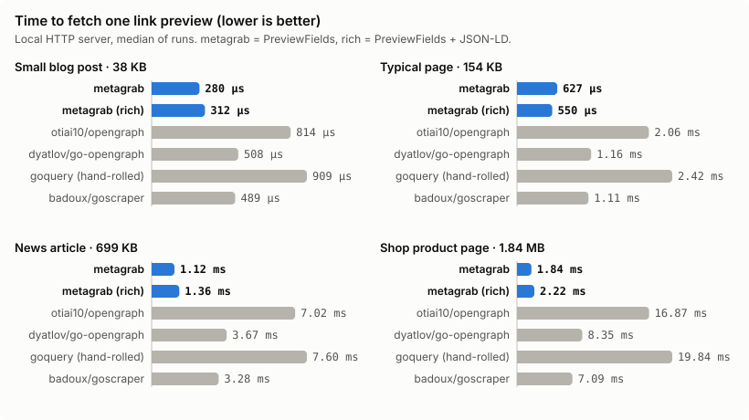

<picture>
  <source media="(prefers-color-scheme: dark)" srcset="assets/banner-dark.svg">
  
</picture>

[](https://github.com/josephgoksu/metagrab/actions/workflows/ci.yml)
[](https://pkg.go.dev/github.com/josephgoksu/metagrab)
[](https://goreportcard.com/report/github.com/josephgoksu/metagrab)
[](https://github.com/josephgoksu/metagrab/releases)
[](LICENSE)

metagrab turns a URL into a link preview: title, description, image, favicon, canonical URL, author, date, Open Graph, Twitter Cards, JSON-LD and oEmbed. Use it as a Go library, a CLI, or a ready-made HTTP API.

- **Fast.** It stops reading at `</head>` when it can. On a 1.8 MB product page it reads 445 KB and returns in 1.94 ms, 3.5x to 9.0x faster than the other Go libraries we tested. [Benchmarks](#benchmarks)
- **Safe to expose.** `WithDenyPrivateNetworks()` blocks private and cloud-metadata addresses on every connection, including redirects and DNS rebinding. Retries, timeouts and body limits are built in.
- **Complete.** One call gives you what a preview card needs, with absolute URLs, the best favicon, charset decoding, and oEmbed for 23 providers.
- **Small.** Only `golang.org/x` dependencies.

## Install

```bash
go get github.com/josephgoksu/metagrab                     # library
brew install --cask josephgoksu/tap/metagrab              # CLI (macOS, Linux)
go install github.com/josephgoksu/metagrab/cmd/metagrab@latest
docker run --rm -p 8080:8080 ghcr.io/josephgoksu/metagrab  # HTTP API
```

Requires Go 1.26 or newer.

## Quick start

```go
link, err := metagrab.Fetch(ctx, "https://go.dev", metagrab.PreviewFields)
if err != nil {
    log.Fatal(err) // *metagrab.FetchError with a machine-readable Code
}
fmt.Println(link.Title, link.Description)
fmt.Println(link.Image)   // absolute URL, ready for an 
fmt.Println(link.Favicon) // best icon, falls back to /favicon.ico
```

Already have the HTML (from a crawler or a cache)? Parse it without a request:

```go
link, err := metagrab.Parse(resp.Body, "https://example.com/post", metagrab.PreviewFields)
```

Add JSON-LD with `RichFields`:

```go
link, err := metagrab.Fetch(ctx, url, metagrab.RichFields)
// link.JSONLD holds the parsed blocks, link.ContentType the first @type ("Article", "Product", ...)
```

## Field masks

Control what gets extracted per request. Use presets or combine individual flags:

| Preset           | Value | What it extracts                         |
| ---------------- | ----- | ---------------------------------------- |
| `MetadataFields` | 15    | Title + URL + OG/Twitter + Description + Image |
| `PreviewFields`  | 111   | MetadataFields + Favicon + Canonical URL |
| `RichFields`     | 239   | PreviewFields + JSON-LD                  |
| `AllFields`      | 255   | RichFields + full HTML body              |

Individual flags for custom combinations:

| Flag               | Value | Extracts                                                                                       |
| ------------------ | ----- | ---------------------------------------------------------------------------------------------- |
| `TitleField`       | 1     | `<title>` tag (falls back to hostname)                                                         |
| `URLField`         | 2     | Validated URL only (no network request)                                                        |
| `MetaField`        | 4     | Open Graph, Twitter Cards, oEmbed, elevated fields (author, site_name, published_at)           |
| `DescriptionField` | 8     | `<meta name="description">`                                                                    |
| `ContentField`     | 16    | Full HTML body content                                                                         |
| `FaviconField`     | 32    | Best favicon URL (`apple-touch-icon` > `icon` > `shortcut icon`, falls back to `/favicon.ico`) |
| `CanonicalField`   | 64    | `<link rel="canonical">` URL                                                                   |
| `JSONLDField`      | 128   | `<script type="application/ld+json">` blocks + `ContentType` from `@type`                      |

Example: metadata + favicon only (no canonical):

```go
mask := metagrab.MetadataFields | metagrab.FaviconField // 47
link, err := metagrab.Fetch(ctx, url, mask)
```

> **Note:** When mask is `0`, `Fetch` defaults to `AllFields` (255). The `httphandler` HTTP adapter defaults to `MetadataFields` (15) when the request omits `fields`.

## Link struct

| Field          | Type                | Source             | Description                                                                    |
| -------------- | ------------------- | ------------------ | ------------------------------------------------------------------------------ |
| `URL`          | `string`            | `URLField`         | Validated URL                                                                  |
| `Title`        | `string`            | `TitleField`       | Page title (falls back to hostname if missing)                                 |
| `Description`  | `string`            | `DescriptionField` | Meta description                                                               |
| `OpenGraph`    | `map[string]string` | `MetaField`        | All `og:*` tags                                                                |
| `Twitter`      | `map[string]string` | `MetaField`        | All `twitter:*` tags                                                           |
| `Content`      | `string`            | `ContentField`     | Full HTML body                                                                 |
| `Favicon`      | `string`            | `FaviconField`     | Best favicon URL                                                               |
| `CanonicalURL` | `string`            | `CanonicalField`   | Canonical URL                                                                  |
| `Image`        | `string`            | `MetaField`        | Best preview image, absolute (`og:image` > `twitter:image` > oEmbed thumbnail) |
| `SiteName`     | `string`            | `MetaField`        | From `og:site_name`, or the oEmbed provider name                               |
| `Author`       | `string`            | `MetaField`        | From `article:author`, `<meta name="author">` or the oEmbed author             |
| `PublishedAt`  | `string`            | `MetaField`        | From `article:published_time` or `<meta name="date">` (raw string, not parsed) |
| `JSONLD`       | `[]map[string]any`  | `JSONLDField`      | Parsed JSON-LD blocks (max 10 per page, 256 KB per block)                      |
| `ContentType`  | `string`            | `JSONLDField`      | First `@type` from JSON-LD (e.g. `"Article"`, `"Person"`)                      |
| `OEmbed`       | `*OEmbedData`       | `MetaField`        | oEmbed data (only when URL matches a known provider)                           |

## Bulk fetch

`FetchBulkResults` fetches multiple URLs concurrently and returns per-URL results (no single failure aborts the batch):

```go
results := metagrab.FetchBulkResults(ctx, urls, metagrab.PreviewFields)
for _, r := range results {
    if r.Error != nil {
        log.Printf("skip %s: %s", r.URL, r.Error.Code)
        continue
    }
    fmt.Println(r.Link.Title)
}
```

## Client options

Create a client with custom configuration:

```go
client := metagrab.NewClient(
    metagrab.WithTimeout(5 * time.Second),
    metagrab.WithRetries(2),
    metagrab.WithConcurrency(20),
    metagrab.WithDenyPrivateNetworks(), // SSRF protection
)
link, err := client.Fetch(ctx, url, metagrab.PreviewFields)
```

| Option            | Default        | Description                                                             |
| ----------------- | -------------- | ----------------------------------------------------------------------- |
| `WithTimeout`     | 10s            | HTTP client timeout (ignored when `WithHTTPClient` is set)              |
| `WithRetries`     | 0              | Retry on 429/502/503/504 with exponential backoff                       |
| `WithRetryDelay`  | 250ms          | Base delay between retries                                              |
| `WithMaxRetryWait` | 30s           | Upper bound for any retry wait, including `Retry-After`                 |
| `WithMaxRedirects` | 5             | Redirects to follow (0 = do not follow)                                 |
| `WithDenyPrivateNetworks` | off    | Block private/reserved addresses at dial time (see SSRF protection)     |
| `WithConcurrency` | 10             | Max parallel fetches for bulk operations                                |
| `WithMaxBodySize` | 2 MB           | Response body size limit                                                |
| `WithURLPolicy`   | nil            | URL allow/deny hook, run before the request and on every redirect       |
| `WithUserAgent`   | `metagrab/1`   | User-Agent header                                                       |
| `WithHTTPClient`  | -              | Bring your own `*http.Client` (timeout and transport managed by caller) |

Package-level functions (`metagrab.Fetch`, `metagrab.FetchBulkResults`) use a default client with the defaults above.

## Error handling

All errors are `*FetchError` with a machine-readable `Code`:

```go
link, err := metagrab.Fetch(ctx, url, metagrab.PreviewFields)
if err != nil {
    var fe *metagrab.FetchError
    if errors.As(err, &fe) {
        switch fe.Code {
        case metagrab.ErrorCodeInvalidURL:
            // bad URL format
        case metagrab.ErrorCodeURLDenied:
            // blocked by URL policy
        case metagrab.ErrorCodeHTTPStatus:
            log.Printf("HTTP %d for %s", fe.StatusCode, fe.URL)
        case metagrab.ErrorCodeCanceled:
            // context was canceled
        }
    }
}
```

| Code                       | Meaning                                                          |
| -------------------------- | ---------------------------------------------------------------- |
| `invalid_url`              | Malformed URL, unsupported scheme, or URL too long (>2048 chars) |
| `url_denied`               | Blocked by URL policy                                            |
| `request_build_failed`     | Could not construct HTTP request                                 |
| `network_error`            | Connection failed                                                |
| `context_canceled`         | Context was canceled                                             |
| `deadline_exceeded`        | Context deadline exceeded                                        |
| `http_status_error`        | Non-2xx HTTP status (after retries)                              |
| `read_body_error`          | Failed to read response body                                     |
| `body_too_large`           | Response body exceeded `MaxBodySize`                             |
| `unsupported_content_type` | Response is not HTML (e.g. JSON, PDF)                            |
| `parse_html_error`         | Failed to parse HTML                                             |

## SSRF protection

If URLs come from users, turn on `WithDenyPrivateNetworks()`:

```go
client := metagrab.NewClient(
    metagrab.WithDenyPrivateNetworks(),
)
```

The check runs in the dialer, after DNS resolution, on every connection. That covers redirects and DNS rebinding. It blocks loopback, RFC 1918, link-local (including cloud metadata at `169.254.169.254`), CGNAT, multicast, documentation, NAT64, IPv6 ULA and IPv4-mapped IPv6 forms of all of these. Blocked requests fail with `url_denied`, and the error wraps `metagrab.ErrPrivateAddress`. Proxy environment variables are ignored in this mode, because a proxy would hide the real target address.

`DenyPrivateIPs()` is still available as a `URLPolicy`. It resolves the host once before the request, so on its own it does not stop DNS rebinding. `IsPublicAddr(netip.Addr)` is exported for your own transports.

If you pass your own client with `WithHTTPClient`, these protections are yours to configure.

## oEmbed support

When `MetaField` is set and the URL matches a known provider, metagrab fetches oEmbed data and fills empty `Title`, `SiteName`, `Author` and `Image` fields. The full oEmbed response is available via `link.OEmbed`:

```go
link, _ := metagrab.Fetch(ctx, "https://www.youtube.com/watch?v=dQw4w9WgXcQ", metagrab.PreviewFields)
fmt.Println(link.OEmbed.Type)         // "video"
fmt.Println(link.OEmbed.AuthorName)   // "Rick Astley"
fmt.Println(link.OEmbed.ThumbnailURL) // thumbnail URL
```

`OEmbedData` fields: `Type`, `Title`, `AuthorName`, `AuthorURL`, `ProviderName`, `ProviderURL`, `ThumbnailURL`, `HTML`, `Width`, `Height`.

Supported providers (23):

| Category | Providers                                 |
| -------- | ----------------------------------------- |
| Video    | YouTube, Vimeo, Dailymotion, TikTok       |
| Audio    | Spotify, SoundCloud                       |
| Social   | Twitter/X, Reddit                         |
| Code     | CodePen, CodeSandbox, JSFiddle, Replit    |
| Design   | Figma                                     |
| Docs     | SlideShare, Speaker Deck                  |
| Media    | Flickr, Giphy, Imgur                      |
| Other    | Loom, Miro, Kickstarter, Mixcloud, Scribd |

## HTTP API

The `httphandler` sub-package wraps a `metagrab.Client` as a standard `http.Handler`:

```go
import "github.com/josephgoksu/metagrab/httphandler"

client := metagrab.NewClient(
    metagrab.WithDenyPrivateNetworks(),
)
h := httphandler.New(client,
    httphandler.WithAPIKey(os.Getenv("API_KEY")),
)
http.ListenAndServe(":8080", h)
```

### Endpoints

**`POST /fetch`** - single URL

```json
{ "url": "https://example.com", "fields": 111 }
```

Returns the `Link` object directly. `fields` defaults to `15` (MetadataFields) when omitted.

Errors return a `FetchError` JSON body. Status codes: `400` for invalid or denied URLs, `422` for non-HTML targets, `504` for timeouts, and `502` for every other upstream failure. A non-2xx response from the target is also `502`, with the target's status in `status_code`.

**`POST /fetch-bulk`** - batch (up to 100 URLs)

```json
{ "urls": ["https://a.com", "https://b.com"], "fields": 111 }
```

Returns `[Link, ...]`. Failed URLs return a Link with only the `url` field populated.

**`GET /health`** - health check

Returns `{"status": "ok"}`. This endpoint does not require the API key, so load balancers can call it.

### Handler options

| Option                 | Default | Description                              |
| ---------------------- | ------- | ---------------------------------------- |
| `WithAPIKey`           | -       | Enable `X-API-Key` header authentication |
| `WithRequestBodyLimit` | 64 KB   | Max request body size                    |
| `WithMaxBulkURLs`      | 100     | Max URLs per `/fetch-bulk` request       |

Deployment examples in `examples/`:

| Runtime              | Directory                                                          | Notes                    |
| -------------------- | ------------------------------------------------------------------ | ------------------------ |
| Standalone           | [`examples/standalone/`](examples/standalone/)                     | ~25 lines                |
| AWS Lambda           | [`examples/lambda/`](examples/lambda/)                             | `provided.al2023`, arm64 |
| Cloudflare Container | [`examples/cloudflare-container/`](examples/cloudflare-container/) | Full Docker on CF edge   |

## CLI

```bash
brew install --cask josephgoksu/tap/metagrab
# or
go install github.com/josephgoksu/metagrab/cmd/metagrab@latest
```

Usage:

```bash
metagrab https://example.com                        # preview (default)
metagrab -fields=metadata https://example.com       # title + OG + description only
metagrab -fields=rich https://example.com           # preview + JSON-LD
metagrab -fields=all https://example.com            # everything including HTML body
metagrab -retries=2 -timeout=5s https://example.com # with retries and custom timeout
metagrab https://a.com https://b.com https://c.com  # bulk fetch (concurrent)
metagrab version
```

| Flag           | Default   | Description                                                      |
| -------------- | --------- | ---------------------------------------------------------------- |
| `-fields`      | `preview` | Preset (`metadata`, `preview`, `rich`, `all`) or numeric bitmask |
| `-timeout`     | `10s`     | HTTP timeout per request                                         |
| `-retries`     | `0`       | Retry attempts for 429/502/503/504                               |
| `-retry-delay` | `250ms`   | Base delay between retries                                       |
| `-concurrency` | `10`      | Parallel fetches when several URLs are given                     |
| `-compact`     | `false`   | One-line JSON output                                             |
| `-quiet`       | `false`   | Do not print timing to stderr                                    |

Exit codes: `0` ok, `1` usage error, `2` one or more URLs failed, `3` internal error.

### Run the HTTP API

```bash
metagrab serve -addr :8080 -api-key "$METAGRAB_API_KEY"
# or
docker run --rm -p 8080:8080 -e METAGRAB_API_KEY=secret ghcr.io/josephgoksu/metagrab
```

`serve` blocks private networks by default (`-allow-private-networks` turns that off for internal use), logs JSON to stderr, sets server timeouts and drains in-flight requests on `SIGTERM`. It reads `METAGRAB_ADDR`, `PORT` and `METAGRAB_API_KEY` from the environment.

## Benchmarks

Time to fetch one link preview from a local server (median, lower is better). Full method, raw numbers and memory charts: [docs/benchmarks](docs/benchmarks/README.md).



| Page | metagrab | metagrab (rich) | Fastest other | Slowest other |
| --- | ---: | ---: | ---: | ---: |
| Small blog post (38 KB) | **292 µs** | 314 µs | 437 µs (badoux/goscraper) | 909 µs (goquery (hand-rolled)) |
| Typical page (154 KB) | **580 µs** | 647 µs | 955 µs (badoux/goscraper) | 2.30 ms (goquery (hand-rolled)) |
| News article (699 KB) | **1.16 ms** | 1.32 ms | 3.06 ms (badoux/goscraper) | 7.30 ms (goquery (hand-rolled)) |
| Shop product page (1.8 MB) | **1.94 ms** | 2.58 ms | 6.82 ms (badoux/goscraper) | 17.49 ms (goquery (hand-rolled)) |

`metagrab` uses `PreviewFields`; `metagrab (rich)` adds JSON-LD, which means scanning the whole body. On a typical page metagrab is 1.6x faster than the fastest alternative, and allocates 99 KB to parse it where the DOM-based libraries allocate up to 533 KB. The libraries do not extract the same fields; see the [feature comparison](docs/benchmarks/README.md#features).

Reproduce on your machine: `cd bench && go run .`

## Running in production

A checklist for running metagrab behind a product (B2B or B2C):

- **SSRF.** Turn on `WithDenyPrivateNetworks()` whenever URLs come from users (`metagrab serve` does by default).
- **Timeouts.** Keep `WithTimeout` short (3-10s) and pass a request `context` so cancelled requests stop fetching.
- **Caching.** Previews change rarely. Cache `Link` results by URL (for example 24h) in front of metagrab; it does not cache for you.
- **Rate limits.** Put the HTTP API behind an API key (`METAGRAB_API_KEY`) and rate limiting at your edge. Use `WithConcurrency` to bound bulk fetches.
- **Retries.** `WithRetries(1-2)` handles 429/502/503/504; waits respect `Retry-After` up to `WithMaxRetryWait`.
- **Rendering.** Treat every returned string as untrusted. Escape it, and never inject `OEmbed.HTML` without a sandboxed iframe.
- **Errors.** Branch on `FetchError.Code`, not on error strings.

## Stability

metagrab follows [semantic versioning](https://semver.org). After v1.0.0, exported API changes are additive within a major version. The JSON field names of `Link` and `FetchError` are part of the API. See [CHANGELOG.md](CHANGELOG.md).

## Contributing

Issues and pull requests are welcome. Read [CONTRIBUTING.md](CONTRIBUTING.md) and [AGENTS.md](AGENTS.md). Report security issues privately, as described in [SECURITY.md](SECURITY.md).

```bash
go test -short -race ./...        # unit tests, no network
go test -tags=integration ./...   # against real websites
```

## License

[Apache 2.0](LICENSE)
